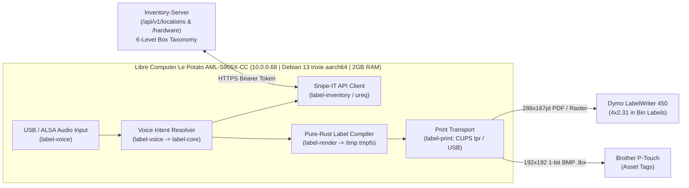

# Label-Agent

> **Label-Agent** is an autonomous, 100% pure-Rust voice-driven inventory and physical labeling appliance. Designed to run headless with a sub-25 MiB memory footprint on edge ARM64 hardware (Libre Computer AML-S905X-CC "Le Potato"), it captures natural-language voice commands, resolves intent against the `Inventory-Server` 6-level location and asset taxonomy, compiles high-density QR and category-indexed thermal labels (`Dymo 30256` 4"×2.31", `Brother P-Touch` `.lbx`, and `ODF/ODT`) strictly in RAM (`tmpfs`), and dispatches jobs directly to physical label printers. **Rust-only, Rust-always: zero garbage collection, zero heavy interpreters, and compile-time hardware/domain correctness.**

---

## Architecture Overview

Label-Agent operates an end-to-end, zero-interpreter pipeline designed for low-memory, low-latency edge deployment:



---

## Multi-Crate Workspace Layout

The repository is organized as a modular Cargo workspace adhering to Google Rust Style:

| Crate | Purpose & Responsibilities | Key Dependencies |
| :--- | :--- | :--- |
| **`label-core`** | Domain models, 6-level location taxonomy, label specifications, page geometries, and voice command intent definitions. | `serde`, `thiserror` |
| **`label-inventory`** | Snipe-IT REST API client (`/api/v1/locations`, `/api/v1/hardware`), bearer authentication, and hierarchical location resolving. | `label-core`, `ureq`, `serde_json` |
| **`label-render`** | Pure-Rust QR generator (`qrcode`), Dymo PDF renderer, BoxLabels `.odt` builder, and Brother P-Touch `.lbx` (1-bit BMP) compiler. | `label-core`, `qrcode`, `image`, `zip` |
| **`label-print`** | Hardware print dispatchers (`lpr -P`, CUPS queue discovery, and dry-run mock transport). | `label-core`, `thiserror` |
| **`label-voice`** | Audio capture trait (16 kHz mono PCM), voice feedback traits, and deterministic utterance-to-intent parsing. | `label-core`, `thiserror` |
| **`label-agent-daemon`** | CLI entrypoint (`label-agent`), `systemd` daemon loop, command dispatch, and runtime configuration. | All crates, `lexopt` |

---

## 6-Level Location Taxonomy (`Inventory-Server`)

All physical boxes and assets are cataloged using a strict 6-level hierarchical tree:

```text
Level 1: Building     (e.g., "Main Campus")
  └── Level 2: Floor        (e.g., "1st Floor")
        └── Level 3: Room         (e.g., "Lab 101")
              └── Level 4: Furniture    (e.g., "Rack Alpha")
                    └── Level 5: SubDivision  (e.g., "Shelf 2")
                          └── Level 6: ContainerBox (e.g., "BOX-001-Wood")
```

### Invariants:
- A printable storage container MUST resolve to **Level 6 (`ContainerBox`)**.
- Lineage is verified in strict order (`1 -> 2 -> 3 -> 4 -> 5 -> 6`).
- Breadcrumbs are formatted with standard delimiters: `Main Campus > 1st Floor > Lab 101 > Rack Alpha > Shelf 2 > BOX-001-Wood`.
- QR code payload encodes the direct web URL: `<base_url>/<label_id>` (e.g., `https://inventory.example.com/box/BOX-001-Wood`).

---

## Physical Label Geometries (`BoxLabels`)

### 1. Dymo 30256 Large Address / Bin Label
- **Dimensions**: `4.0 in` width $\times$ `2.3098 in` height (`288.0 pt` $\times$ `166.3056 pt` / `167.24 pt` CUPS page).
- **Margins**: `0.1701 in` (`12.2472 pt`) on all edges.
- **Header**: Category icon frame (`0.7 in` $\times$ `0.7 in`), full location breadcrumb, box code title.
- **QR Code**: `0.7 in` $\times$ `0.7 in` high-density matrix (`EcLevel::M`).
- **Body**: Dynamic bulleted item inventory (`\u{2022}`).

### 2. Brother P-Touch `.lbx` Archive
- **Container Format**: Open ZIP container holding `prop.xml`, `label.xml`, and raster graphic `Object0.bmp`.
- **Graphic Specification**: `192x192` 1-bit monochrome uncompressed BMP (`4670` bytes total: 62-byte header/palette + 24-byte row stride $\times$ 192 rows).

---

## Target Hardware Profile: Raspberry Pi 3 Model B+

Label-Agent is engineered to run on the decommissioned edge SBC (`10.0.0.10`, `sbc-lyrion` -> `sbc-label-agent`):

| Hardware Attribute | Audited Telemetry & Constraint | Pure-Rust Appliance Alignment |
| :--- | :--- | :--- |
| **Model & SoC** | Raspberry Pi 3B+ Rev 1.3 (`BCM2837B0`, Sony UK `a020d3`) | Native `aarch64` cross-compilation (`Cortex-A53`). |
| **CPU Clock & Governor** | 4x ARM Cortex-A53 @ 1.40 GHz, `performance` governor | Lightweight deterministic CPU utilization; no JIT pauses. |
| **Memory Ceiling** | 1 GB LPDDR2 SDRAM (`906–908 MiB` usable) | Sub-25 MiB runtime resident set size (`RSS`); `MemoryMax=256M`. |
| **MicroSD Latency** | `159.35 ms` average write await on `/dev/mmcblk0p2` | All label compilation and QR rendering occurs strictly in `/tmp` (`454 MiB` in-RAM `tmpfs`), eliminating flash wear. |
| **Power Budget** | Micro-USB B 5.1V / 2.5A; `throttled=0x0` clean thermal record | Combined peripheral USB draw kept $< 250\text{ mA}$. |
| **Target OS & Kernel** | Debian 13.6 (`trixie`) `aarch64`, Kernel `6.12.43+rpt-rpi-v8` | Cross-compiled against standard `glibc` / `aarch64-unknown-linux-gnu`. |

---

## CLI Usage Examples

```bash
# Print a box label directly to Dymo LabelWriter 450
label-agent --command "print box label for BOX-042 on dymo" --printer Dymo_LabelWriter_450

# Perform a dry-run test (renders artifacts in /tmp/label-agent without sending to printer)
label-agent --command "print box label for BOX-042 on dymo" --dry-run

# Query inventory contents via voice intent parser
label-agent --command "what is inside box BOX-042"

# Check out an asset to a box location
label-agent --command "check out asset ASSET-109 to box BOX-042"

# Relocate a container box to a new parent location
label-agent --command "move box BOX-042 to shelf S2"

# Run in background daemon mode listening on ALSA/USB audio input
label-agent --daemon --spool-dir /tmp/label-agent --printer Dymo_LabelWriter_450
```

---

## Google Rust Style Verification

Enforce zero-warning compliance across all crates:

```bash
# 1. Format check
cargo fmt --all -- --check

# 2. Workspace compilation check
cargo check --workspace --all-targets

# 3. Clippy strict lints (-D warnings)
cargo clippy --workspace --all-targets -- -D warnings

# 4. Google Rust Style mechanical audit
python /home/console-admin/.gemini/config/plugins/rust-pro/skills/rust-pro/scripts/google_rust_audit.py /home/console-admin/Github/Label-Agent --strict

# 5. Full test suite execution
cargo test --workspace --all-targets

# 6. Raspberry Pi 3B+ (ARM64) cross-compilation check
rustup target add aarch64-unknown-linux-gnu
cargo check --workspace --target aarch64-unknown-linux-gnu
```

---

## License

This project is licensed under either the [MIT License](LICENSE) or the Apache License 2.0.
