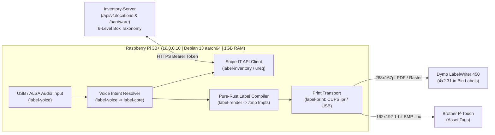

# Label-Agent Repository & Pure-Rust Foundation Implementation Plan

> **For agentic workers:** REQUIRED SUB-SKILL: Use `superpowers:subagent-driven-development` (recommended) or `superpowers:executing-plans` to implement this plan task-by-task. Steps use checkbox (`- [ ]`) syntax for tracking.

**Goal:** Establish `/home/console-admin/Github/Label-Agent` (and remote `github.com/Mr-Molina/Label-Agent`) as a 100% pure-Rust, Google-Rust-Style-compliant multi-crate workspace that ingests spoken commands, queries/mutates `Inventory-Server` (Snipe-IT REST API & 6-Level Location Taxonomy), deterministically compiles thermal/box labels (`BoxLabels` 4"x2.31" Dymo 30256 & Brother P-Touch `.lbx`), and dispatches print jobs on the target Raspberry Pi 3 Model B+ (`sbc-lyrion` / `10.0.0.10`, Debian 13 `trixie` `aarch64`).

**Architecture:** A 6-crate pure-Rust Cargo workspace (`label-core`, `label-voice`, `label-inventory`, `label-render`, `label-print`, `label-agent-daemon`) engineered for the 1 GB LPDDR2 RAM (`~906 MiB` usable) and slow microSD write latency (`159.35 ms` write await) of the Raspberry Pi 3B+. All HTTP calls use lightweight synchronous `ureq`; all label artifacts (QR codes, 4"x2.3098" Dymo PDF/raster, `.odt`, and Brother `.lbx` 1-bit BMP) are compiled in pure Rust inside `/tmp` (`454 MiB` in-RAM `tmpfs`) with zero Python or LibreOffice dependencies.

**Tech Stack:** Rust (Edition 2021, `x86_64-unknown-linux-gnu` dev host + `aarch64-unknown-linux-gnu` Pi 3B+ target), `thiserror`, `serde`, `serde_json`, `ureq`, `qrcode`, `image`, `zip`, `lexopt`, `systemd` unit hardening, GitHub CLI (`gh`), and `.agents/` workspace governance (`google_rust_audit.py --strict`).

**Spec:** [`/home/console-admin/Github/Label-Agent/retired_raspberry_pi_dossier.md`](file:///home/console-admin/Github/Label-Agent/retired_raspberry_pi_dossier.md), [`/home/console-admin/Github/Inventory-Server`](file:///home/console-admin/Github/Inventory-Server), and [`/home/console-admin/Github/BoxLabels`](file:///home/console-admin/Github/BoxLabels).

---

## 1. Mission Statement & Architectural Overview

### Polished Mission Statement (for `README.md` & GitHub Description)
> **Label-Agent** is an autonomous, 100% pure-Rust voice-driven inventory and physical labeling appliance. Designed to run headless with a sub-25 MiB memory footprint on edge ARM64 hardware (Raspberry Pi 3 Model B+), it captures natural-language voice commands, resolves intent against the `Inventory-Server` 6-level location and asset taxonomy, compiles high-density QR and category-indexed thermal labels (`Dymo 30256` 4"×2.31", `Brother P-Touch` `.lbx`, and `ODF/ODT`) strictly in RAM (`tmpfs`), and dispatches jobs directly to physical label printers. **Rust-only, Rust-always: zero garbage collection, zero heavy interpreters, and compile-time hardware/domain correctness.**

### End-to-End Pipeline Architecture



### Target Hardware Constraints & Alignment ([`retired_raspberry_pi_dossier.md`](file:///home/console-admin/Github/Label-Agent/retired_raspberry_pi_dossier.md))
| Hardware / OS Attribute | Audited Pi 3B+ Specification | Architectural Design Response |
| :--- | :--- | :--- |
| **CPU & ISA** | 4x ARM Cortex-A53 @ 1.40 GHz (`aarch64-unknown-linux-gnu`), `performance` governor | Pure-Rust native `aarch64` binary; `[profile.release]` uses `lto = "thin"` and `codegen-units = 1`. |
| **Memory Ceiling** | 1 GB LPDDR2 (`906–908 MiB` usable), `200 MiB` swap (`swappiness=10`) | Zero Python/JVM/LibreOffice processes; `ureq` sync HTTP + bounded audio ring buffer + `MemoryMax=256M` in `systemd`. |
| **MicroSD Write Latency** | `159.35 ms` avg write await on `/dev/mmcblk0p2`; `/tmp` is a `454 MiB` RAM `tmpfs` | All rendered QR PNGs, PDFs, `.odt`, and `.lbx` files are written exclusively to `/tmp/label-agent` (`tmpfs`), eliminating SD wear and write stalls. |
| **Masked System Services** | `ntpsec.service`, `cups.service`, `cups.socket`, `avahi-daemon.service` masked in decommission | Deployment runbook & provisioning script explicitly unmask `ntpsec.service` (required for HTTPS/TLS validation) and `cups.socket`/`cups.service` for local USB printer spooling. |
| **USB Power Budget** | 4x USB 2.0 ports sharing `1.2A` max combined peripheral current | USB microphone + externally-powered Dymo/Brother thermal printer keeps USB bus draw `< 250 mA`. |

---

## 2. Global Constraints

- **Rust-Only, Rust-Always**: Zero Python, Node.js, PHP, or shell-script runtime dependencies in the application pipeline.
- **Google Rust Style Guide Compliance (`GRS-001`..`GRS-012`)**:
  - `lib.rs` and `mod.rs` files MUST contain **only** `mod` declarations and `pub use` re-exports (`GRS-003`). All `struct`, `enum`, `trait`, and `fn` definitions reside in leaf `.rs` modules.
  - `imports_granularity = "Module"` (`GRS-001`: one module per `use` statement, zero `::` inside `{ ... }`), zero glob imports (`GRS-002`) outside `#[cfg(test)] mod tests { use super::*; }`.
  - Zero `.unwrap()` in non-test code (`GRS-010`); propagate via `Result<T, E>` (`thiserror`) and `?`.
  - Omit `get_` prefixes on getters (`GRS-011`), replace boolean parameters with 2-variant domain `enum`s (`§6.1`), and annotate cross-crate public structs/enums with `#[non_exhaustive]` (`§13.7`) and pure constructors/getters with `#[must_use]`.
  - Code width $\le 100$ columns, standalone comments $\le 80$ columns (`GRS-012`).
- **6-Level Inventory Location Taxonomy**: `Building (L1) -> Floor (L2) -> Room (L3) -> Furniture (L4) -> SubDivision (L5) -> ContainerBox (L6)`. Boxes are Level 6 `locations` in Snipe-IT.
- **Exact `BoxLabels` Physical Geometry**:
  - Dymo 30256 Label: `4.0 in` width (`288.0 pt`) $\times$ `2.3098 in` height (`166.3056 pt` / `167.24 pt` CUPS page), margins `0.1701 in` (`12.2472 pt`), QR frame `0.7 in` $\times$ `0.7 in` (`EcLevel::M`), Icon frame `0.7 in` $\times$ `0.7 in`, bullet character `\u{2022}`.
  - Brother P-Touch `.lbx`: ZIP container with `prop.xml`, `label.xml`, and `Object0.bmp` (`192x192` 1-bit monochrome uncompressed BMP).
- **RAM-Only Spooling**: Default spool directory MUST be `/tmp/label-agent` (`tmpfs`).

---

## 3. Review Focus (Top 5 Edge Cases & Failure Modes Pinned by Tests)

1. **Invalid or Incomplete 6-Level Location Hierarchy**: Attempting to print a "Box Label" for a Level 3 (`Room`) location or an orphan node must return a typed `TaxonomyError::InvalidContainerDepth { expected: 6, actual }` unless explicitly overridden as a location plaque.
2. **XML / ZPL / ODF Special-Character Injection in Spoken Item Names**: Spoken or Snipe-IT item names containing `&`, `<`, `>`, `"`, or `'` (e.g., `"AT&T Cat6 Cable <5ft>"`) must be strictly XML-escaped before injecting into `.odt` `content.xml` or `.lbx` `label.xml`.
3. **1-Bit Monochrome BMP Row Padding & Stride Alignment**: Brother P-Touch `192x192` 1-bit BMP generation must enforce 4-byte (`32-bit`) row stride alignment (`192 / 8 = 24` bytes per row) and valid 62-byte BMP header + 2-color palette so P-Touch hardware never rejects `Object0.bmp`.
4. **Spool Path Safety & Non-`tmpfs` Path Traversal**: Label names containing `/` or `..` (e.g., `"BOX-001/../../etc"`) must be sanitized to safe file stems (`"BOX-001_etc"`) confined strictly inside the configured spool directory (`/tmp/label-agent`).
5. **Unreachable `Inventory-Server` or HTTP `401`/`429` Responses**: Network timeouts or invalid `SNIPEIT_API_KEY` must surface structured `InventoryError::Unauthorized` or `InventoryError::RateLimited` without panicking or blocking the voice loop indefinitely (enforcing a strict `5s` connect / `10s` read timeout on `ureq`).

---

## 4. Target Repository File Structure

```text
/home/console-admin/Github/Label-Agent/
├── .agents/                                  # Seeded by wakeup_bootstrap.py (AGENTS.md, INFRASTRUCTURE_INVARIANTS.md, sessions.md)
│   └── knowledge/
│       └── work_orders/INDEX.md
├── .cargo/
│   └── config.toml                           # Host & aarch64-unknown-linux-gnu cross-compilation config
├── .github/
│   └── workflows/
│       └── ci.yml                            # GitHub Actions: fmt, clippy -D warnings, google_rust_audit, test, aarch64 check
├── .gitignore
├── Cargo.toml                                # Workspace manifest + [workspace.lints.rust] & [workspace.lints.clippy]
├── LICENSE                                   # MIT / Apache-2.0
├── README.md                                 # Mission statement, architecture, Pi 3B+ deployment guide
├── retired_raspberry_pi_dossier.md           # Existing hardware dossier (preserved untouched)
├── rustfmt.toml                              # Google Rust Style Guide formatting config
├── deploy/
│   ├── systemd/
│   │   └── label-agent.service               # Hardened systemd unit for Pi 3B+ (10.0.0.10)
│   └── pi3b-prep-checklist.md                # Step-by-step runbook for 10.0.0.10 (unmask ntpsec/cups, purge lyrion)
└── crates/
    ├── label-core/                           # Pure domain types, 6-level taxonomy, intents, geometry constants
    │   ├── Cargo.toml
    │   └── src/
    │       ├── lib.rs                        # Pure manifest (mod + pub use only)
    │       ├── error.rs                      # CoreError enum
    │       ├── intent.rs                     # VoiceCommandIntent, PrintMode, LabelFormat
    │       ├── label_spec.rs                 # BoxLabelSpec, AssetLabelSpec, PageGeometry (4.0"x2.3098")
    │       └── taxonomy.rs                   # TaxonomyLevel (L1..L6), LocationNode, LocationPath
    ├── label-inventory/                      # Snipe-IT REST API client (ureq)
    │   ├── Cargo.toml
    │   └── src/
    │       ├── lib.rs                        # Pure manifest
    │       ├── client.rs                     # SnipeItClient, InventoryConfig, HTTP timeouts
    │       ├── error.rs                      # InventoryError
    │       └── models.rs                     # AssetDto, LocationDto, PaginatedResponse
    ├── label-render/                         # Pure-Rust QR, PDF, ODT, and Brother .lbx / 1-bit BMP compiler
    │   ├── Cargo.toml
    │   └── src/
    │       ├── lib.rs                        # Pure manifest
    │       ├── bmp.rs                        # 1-bit monochrome BMP encoder (192x192 for Brother .lbx)
    │       ├── dymo_pdf.rs                   # Pure-Rust PDF generator for 288pt x 166.3pt Dymo 30256 labels
    │       ├── error.rs                      # RenderError
    │       ├── lbx.rs                        # Brother P-Touch .lbx ZIP/XML/BMP archive builder
    │       ├── odt.rs                        # BoxLabels-compatible .odt ODF archive builder + XML escaping
    │       ├── qr.rs                         # Pure-Rust QR code matrix & PNG encoder (EcLevel::M)
    │       └── spool.rs                      # Safe /tmp/label-agent file stem sanitizer & writer
    ├── label-print/                          # Hardware print dispatchers (CUPS lpr, raw USB, dry-run mock)
    │   ├── Cargo.toml
    │   └── src/
    │       ├── lib.rs                        # Pure manifest
    │       ├── cups.rs                       # lpstat queue discovery & lpr -P dispatcher
    │       ├── error.rs                      # PrintError
    │       └── transport.rs                  # PrintTransport trait, PrintJob, DryRunTransport
    ├── label-voice/                          # Voice command capture, intent parser & audio feedback trait
    │   ├── Cargo.toml
    │   └── src/
    │       ├── lib.rs                        # Pure manifest
    │       ├── capture.rs                    # AudioSource trait & PCM frame config (16kHz mono)
    │       ├── error.rs                      # VoiceError
    │       └── parser.rs                     # Deterministic transcript-to-VoiceCommandIntent parser & LLM/STT trait
    └── label-agent-daemon/                   # Main binary crate (`label-agent`)
        ├── Cargo.toml
        └── src/
            ├── main.rs                       # Entrypoint delegating to app::run()
            ├── app.rs                        # End-to-end orchestrator loop
            └── cli.rs                        # CLI argument parser (lexopt) & config loader
```

---

## 5. Task-by-Task Implementation Plan

### Task 1: Repository Initialization, `.agents/` Governance, & Cargo Workspace Scaffolding

**Files:**
- Create: `/home/console-admin/Github/Label-Agent/.gitignore`
- Create: `/home/console-admin/Github/Label-Agent/rustfmt.toml`
- Create: `/home/console-admin/Github/Label-Agent/.cargo/config.toml`
- Create: `/home/console-admin/Github/Label-Agent/Cargo.toml`
- Create: `/home/console-admin/Github/Label-Agent/README.md`
- Create: `/home/console-admin/Github/Label-Agent/.agents/` (via `wakeup_bootstrap.py`)

**Interfaces:**
- Consumes: [`retired_raspberry_pi_dossier.md`](file:///home/console-admin/Github/Label-Agent/retired_raspberry_pi_dossier.md)
- Produces: Workspace `[workspace.lints.rust]` and `[workspace.lints.clippy]` inherited by all 6 crates (`[lints] workspace = true`).

- [ ] **Step 1: Initialize Git repository (`main` branch) and run `wakeup_bootstrap.py` to seed `.agents/` governance**
  Run: `git init -b main "/home/console-admin/Github/Label-Agent" && python "/home/console-admin/.gemini/config/skills/wakeup/scripts/wakeup_bootstrap.py" --workspace "/home/console-admin/Github/Label-Agent"`
  Expected: `.git` and `.agents/` (`AGENTS.md`, `INFRASTRUCTURE_INVARIANTS.md`, `sessions.md`) created.

- [ ] **Step 2: Write `.gitignore`, `rustfmt.toml`, `.cargo/config.toml`, and `README.md`**
  Configure `rustfmt.toml` with the Google Rust Style stable baseline (`max_width = 100`, `tab_spaces = 4`, `reorder_imports = true`, `reorder_modules = true`, `use_field_init_shorthand = true`, `use_try_shorthand = true`, `remove_nested_parens = true`). Configure `README.md` with the refined mission statement, crate topology table, and Raspberry Pi 3B+ (`10.0.0.10`) target profile.

- [ ] **Step 3: Write root `Cargo.toml` with all 6 workspace members and Google Style `[workspace.lints]`**
  Include `members = ["crates/label-core", "crates/label-inventory", "crates/label-render", "crates/label-print", "crates/label-voice", "crates/label-agent-daemon"]`, `resolver = "2"`, `[profile.release]` (`lto = "thin"`, `codegen-units = 1`, `strip = "symbols"`), and `[workspace.lints.rust]` / `[workspace.lints.clippy]` from `rust-pro`.

---

### Task 2: `label-core` — 6-Level Location Taxonomy, Label Geometry, & Voice Intent Contracts

**Files:**
- Create: `crates/label-core/Cargo.toml`
- Create: `crates/label-core/src/lib.rs`
- Create: `crates/label-core/src/error.rs`
- Create: `crates/label-core/src/taxonomy.rs`
- Create: `crates/label-core/src/label_spec.rs`
- Create: `crates/label-core/src/intent.rs`

**Interfaces:**
- Consumes: `thiserror`, `serde`
- Produces:
  - `TaxonomyLevel` (`Building = 1`, `Floor = 2`, `Room = 3`, `Furniture = 4`, `SubDivision = 5`, `ContainerBox = 6`)
  - `LocationNode { id: u64, name: String, parent_id: Option<u64>, level: TaxonomyLevel }`
  - `LocationPath::from_lineage(nodes: &[LocationNode]) -> Result<Self, CoreError>`
  - `PageGeometry::dymo_30256() -> Self` (`width_in: 4.0`, `height_in: 2.3098`, `margin_in: 0.1701`, `qr_size_in: 0.7`, `icon_size_in: 0.7`)
  - `BoxLabelSpec::new(label_id: &str, base_url: &str, category_icon: &str, location_path: LocationPath, items: Vec<String>) -> Result<Self, CoreError>`
  - `VoiceCommandIntent` (`PrintBoxLabel { box_code: String, format: LabelFormat }`, `QueryBoxContents { box_code: String }`, `CheckOutAssetToBox { asset_tag: String, box_code: String }`, `RelocateBox { box_code: String, target_parent_code: String }`)

- [ ] **Step 1: Write `crates/label-core` leaf modules and unit tests**
  Include tests pinning:
  - Valid 6-level `LocationPath` construction (`Main Campus > F1 > R101 > Rack1 > S1 > Box42`) and rejection of non-Level-6 container paths (`CoreError::InvalidContainerDepth { expected: 6, actual: 3 }`).
  - `BoxLabelSpec::qr_payload_url()` formatting `<base_url>/<label_id>` (e.g., `https://inventory.example.com/box/BOX-001-Wood`).
  - `PageGeometry::dymo_30256()` point conversions (`288.0 pt` $\times$ `166.3056 pt`).

- [ ] **Step 2: Verify `label-core` compiles and passes tests + Clippy**
  Run: `cargo test -p label-core && cargo clippy -p label-core --all-targets -- -D warnings`
  Expected: PASS with 0 warnings.

---

### Task 3: `label-inventory` — Snipe-IT REST API Client (`ureq`) & 6-Level Resolver

**Files:**
- Create: `crates/label-inventory/Cargo.toml`
- Create: `crates/label-inventory/src/lib.rs`
- Create: `crates/label-inventory/src/error.rs`
- Create: `crates/label-inventory/src/models.rs`
- Create: `crates/label-inventory/src/client.rs`

**Interfaces:**
- Consumes: `label-core`, `ureq`, `serde`, `serde_json`
- Produces:
  - `InventoryConfig::new(base_url: &str, api_token: &str, timeout: Duration) -> Result<Self, InventoryError>`
  - `InventoryRepository` trait (`find_location_by_code(&self, code: &str) -> Result<LocationDto, InventoryError>`, `list_assets_in_location(&self, location_id: u64) -> Result<Vec<AssetDto>, InventoryError>`, `assign_asset_to_location(&self, asset_id: u64, location_id: u64) -> Result<(), InventoryError>`)
  - `SnipeItClient` implementing `InventoryRepository` against `/api/v1/locations` and `/api/v1/hardware` with `Authorization: Bearer <token>`.

- [ ] **Step 1: Implement `models.rs`, `error.rs`, and `client.rs` with unit tests**
  Test JSON deserialization of Snipe-IT `/api/v1/locations` and `/api/v1/hardware` responses, bearer header construction, and HTTP 401/429 error mapping (`InventoryError::Unauthorized`, `InventoryError::RateLimited`).

- [ ] **Step 2: Verify `label-inventory` tests and Clippy**
  Run: `cargo test -p label-inventory && cargo clippy -p label-inventory --all-targets -- -D warnings`
  Expected: PASS with 0 warnings.

---

### Task 4: `label-render` — Pure-Rust QR, Dymo PDF, `BoxLabels` `.odt`, & Brother `.lbx` Compiler

**Files:**
- Create: `crates/label-render/Cargo.toml`
- Create: `crates/label-render/src/lib.rs`
- Create: `crates/label-render/src/error.rs`
- Create: `crates/label-render/src/qr.rs`
- Create: `crates/label-render/src/bmp.rs`
- Create: `crates/label-render/src/odt.rs`
- Create: `crates/label-render/src/lbx.rs`
- Create: `crates/label-render/src/dymo_pdf.rs`
- Create: `crates/label-render/src/spool.rs`

**Interfaces:**
- Consumes: `label-core`, `qrcode`, `image`, `zip`
- Produces:
  - `QrRendered::encode_png(payload: &str, size_px: u32) -> Result<Vec<u8>, RenderError>` (`EcLevel::M`)
  - `encode_monochrome_bmp_192(qr_payload: &str) -> Result<Vec<u8>, RenderError>` (`192x192` 1-bit uncompressed BMP with 62-byte header and 24-byte row stride)
  - `compile_odt_label(spec: &BoxLabelSpec) -> Result<Vec<u8>, RenderError>` (valid ODF ZIP with `mimetype` uncompressed first, XML-escaped `content.xml`, `styles.xml` at `4.0in x 2.3098in`, and `META-INF/manifest.xml`)
  - `compile_lbx_label(spec: &BoxLabelSpec) -> Result<Vec<u8>, RenderError>` (Brother P-Touch `.lbx` ZIP containing `prop.xml`, `label.xml`, and `Object0.bmp`)
  - `compile_dymo_pdf(spec: &BoxLabelSpec) -> Result<Vec<u8>, RenderError>` (`[288.0, 166.31]` pt landscape PDF with QR, breadcrumb header, and `\u{2022}` item list)
  - `SpoolManager::write_artifact(&self, label_id: &str, ext: &str, bytes: &[u8]) -> Result<PathBuf, RenderError>` (defaults to `/tmp/label-agent`, sanitizing path traversal attempts).

- [ ] **Step 1: Implement leaf modules and unit tests for all 5 edge cases**
  Include tests verifying:
  - XML escaping of `"AT&T <Cat6> & 'Fiber'"` inside `content.xml` and `label.xml`.
  - `encode_monochrome_bmp_192` produces exact `62 + (24 * 192) = 4670` byte 1-bit BMP with `BM` magic header.
  - `compile_odt_label` places `mimetype` (`application/vnd.oasis.opendocument.text`) as the first uncompressed entry in the ZIP archive.
  - `SpoolManager` strips `../` and `/` from `"BOX-001/../../etc"` and writes strictly inside `/tmp/label-agent`.

- [ ] **Step 2: Verify `label-render` tests and Clippy**
  Run: `cargo test -p label-render && cargo clippy -p label-render --all-targets -- -D warnings`
  Expected: PASS with 0 warnings.

---

### Task 5: `label-print` & `label-voice` — Hardware Print Transport & Voice Intent Engine

**Files:**
- Create: `crates/label-print/Cargo.toml`
- Create: `crates/label-print/src/lib.rs`
- Create: `crates/label-print/src/error.rs`
- Create: `crates/label-print/src/transport.rs`
- Create: `crates/label-print/src/cups.rs`
- Create: `crates/label-voice/Cargo.toml`
- Create: `crates/label-voice/src/lib.rs`
- Create: `crates/label-voice/src/error.rs`
- Create: `crates/label-voice/src/capture.rs`
- Create: `crates/label-voice/src/parser.rs`

**Interfaces:**
- Consumes: `label-core`
- Produces:
  - `PrintTransport` trait (`dispatch(&self, job: &PrintJob) -> Result<PrintReceipt, PrintError>`)
  - `CupsTransport::new(queue_name: &str, lpr_binary: PathBuf)` (verifies `/usr/bin/lpr` path and builds `-P <queue>` args)
  - `DryRunTransport` (captures dispatched `PrintJob` records in-memory for deterministic testing)
  - `parse_spoken_command(utterance: &str) -> Result<VoiceCommandIntent, VoiceError>` (parses natural utterances such as `"print box label for BOX-042 on dymo"`, `"what is inside box BOX-042"`, `"check out asset ASSET-109 to box BOX-042"`, and `"move box BOX-042 to shelf S2"`).

- [ ] **Step 1: Implement `label-print` and `label-voice` leaf modules with unit tests**
  Test `CupsTransport` argument construction, `DryRunTransport` job recording, and `parse_spoken_command` across all 4 intent variants plus unrecognized utterance handling (`VoiceError::UnrecognizedIntent`).

- [ ] **Step 2: Verify `label-print` and `label-voice` tests and Clippy**
  Run: `cargo test -p label-print -p label-voice && cargo clippy -p label-print -p label-voice --all-targets -- -D warnings`
  Expected: PASS with 0 warnings.

---

### Task 6: `label-agent-daemon`, Raspberry Pi 3B+ (`10.0.0.10`) Deployment Assets, CI, & GitHub Push

**Files:**
- Create: `crates/label-agent-daemon/Cargo.toml`
- Create: `crates/label-agent-daemon/src/main.rs`
- Create: `crates/label-agent-daemon/src/app.rs`
- Create: `crates/label-agent-daemon/src/cli.rs`
- Create: `deploy/systemd/label-agent.service`
- Create: `deploy/pi3b-prep-checklist.md`
- Create: `.github/workflows/ci.yml`
- Create: `LICENSE`

**Interfaces:**
- Consumes: `label-core`, `label-inventory`, `label-render`, `label-print`, `label-voice`, `lexopt`
- Produces:
  - Binary `label-agent` supporting `--command "<spoken text>"`, `--dry-run`, `--spool-dir /tmp/label-agent`, `--printer Dymo_LabelWriter_450`, and `--daemon`.
  - End-to-end integration test verifying: spoken utterance $\to$ mock `InventoryRepository` lookup $\to$ pure-Rust PDF/ODT/LBX compilation in `/tmp` $\to$ `DryRunTransport` receipt verification.

- [ ] **Step 1: Implement `label-agent-daemon`, `deploy/systemd/label-agent.service`, `deploy/pi3b-prep-checklist.md`, `.github/workflows/ci.yml`, and `LICENSE`**
  - `deploy/systemd/label-agent.service` binds `User=console-admin`, `SupplementaryGroups=audio lp`, `MemoryMax=256M`, `PrivateTmp=yes`, `Environment=LABEL_AGENT_SPOOL_DIR=/tmp/label-agent`.
  - `deploy/pi3b-prep-checklist.md` documents the exact commands for `10.0.0.10` (`sbc-lyrion`) to purge dormant Lyrion/NGINX (`+1.2 GB`), unmask `ntpsec.service` and `cups.service`, and install the `aarch64-unknown-linux-gnu` binary to `/usr/local/bin/label-agent`.

- [ ] **Step 2: Run full Google Rust Style & Workspace Verification Gate**
  Run:
  ```bash
  cargo fmt --all -- --check
  cargo check --workspace --all-targets
  cargo clippy --workspace --all-targets -- -D warnings
  python /home/console-admin/.gemini/config/plugins/rust-pro/skills/rust-pro/scripts/google_rust_audit.py /home/console-admin/Github/Label-Agent --strict
  cargo test --workspace --all-targets
  ```
  Expected: 0 formatting diffs, 0 Clippy warnings, 0 `google_rust_audit.py --strict` violations, 100% tests passing.

- [ ] **Step 3: Commit baseline and publish to GitHub (`Mr-Molina/Label-Agent`)**
  Run:
  ```bash
  git add -A
  git commit -m "feat: initialize pure-Rust Label-Agent workspace, 6-crate pipeline, and Pi 3B+ deployment infrastructure"
  /usr/bin/gh repo create Mr-Molina/Label-Agent --private --source=/home/console-admin/Github/Label-Agent --remote=origin --description "Autonomous 100% pure-Rust voice-driven inventory and thermal label printing agent for ARM64 edge hardware" --push
  ```
  Expected: Repository created on GitHub under `Mr-Molina/Label-Agent` and `main` branch pushed and verified.
